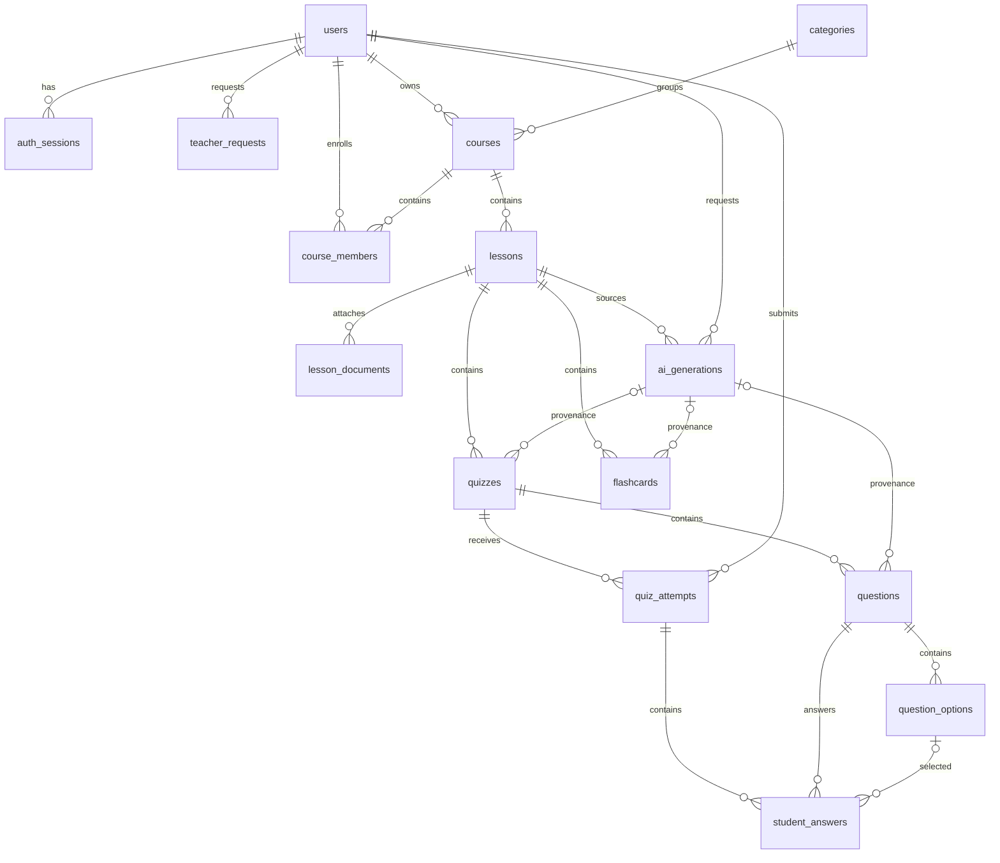

# ERD logic

Tên bảng/field chính theo `data-dictionary.md`. Đây là sơ đồ thiết kế, chưa sinh SQL.

Các FK audit (created_by, decided_by, uploaded_by) và nguồn document nullable được mô tả trong từ điển để sơ đồ dễ đọc. `course_members` có PK kép. `student_answers.selected_option_id` nullable biểu diễn bỏ trống. User dùng một role, không có bảng multi-role ở MVP.
