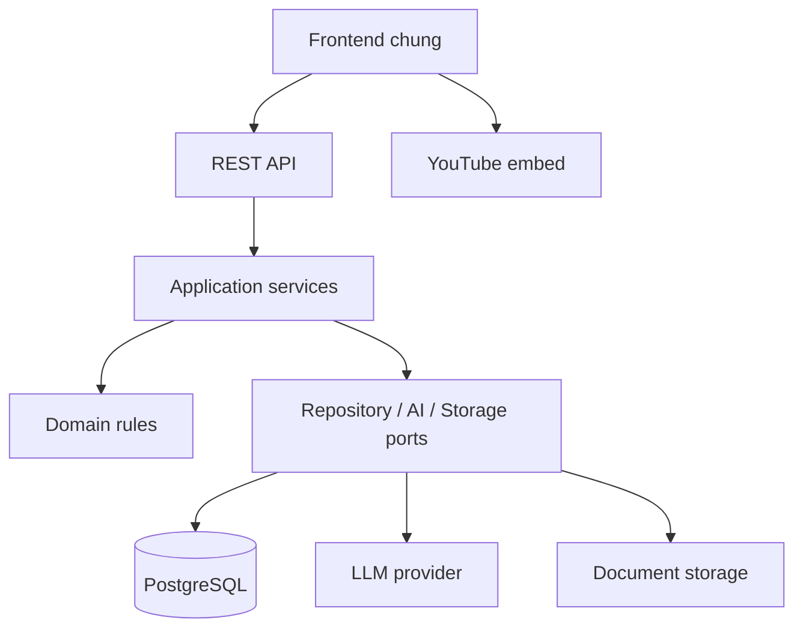

# Kiến trúc

**Modular monolith:** một ứng dụng backend với module rõ ràng. Java làm trước; Python thay thế sau. Chưa cần microservice.

Controller/router → application service → domain + interfaces. Adapter persistence/security/AI/storage triển khai interfaces. Domain không phụ thuộc HTTP, framework, ORM hay LLM vendor. Entity/model ORM thuộc persistence; DTO/schema tại biên API. Không trả entity trực tiếp.

| Module | Sở hữu/trách nhiệm |
|---|---|
| identity | users, sessions, Teacher approval |
| catalog | categories |
| course | courses, publication/archive |
| enrollment | course_members |
| lesson | lessons, documents/transcript |
| assessment | quizzes, questions, options |
| learning | attempts, answers, chấm điểm, lịch sử |
| flashcard | flashcards, review/publish |
| ai | generations, điều phối sinh và validate candidate |
| statistics | Query tổng hợp; không sao chép dữ liệu nghiệp vụ |

AI trả candidate đã kiểm tra; assessment/flashcard service lưu draft qua API CRUD. AI không tự xuất bản hay viết trực tiếp bảng module khác. Statistics có query đọc chuyên biệt. Module gọi nhau qua service/port công khai; controller không chạm repository của module khác.

`shared` chỉ có lỗi, time/ID, request context và tiện ích nhỏ; không chứa nghiệp vụ. Không tạo generic repository hoặc framework tự chế nếu chưa có nhu cầu.

Ghi danh có UNIQUE/PK chống race. Submit transaction ngắn có khóa/kiểm soát phiên bản attempt. Gọi LLM/upload file ngoài transaction DB, sau đó transaction ngắn lưu metadata; dọn file nếu ghi DB lỗi. Lưu provenance AI, không log secret/nội dung riêng.

Java/Python giữ ranh giới module giống nhau. So sánh test trên hai DB riêng cùng fixture; production/dev chạy một backend tại một thời điểm.
